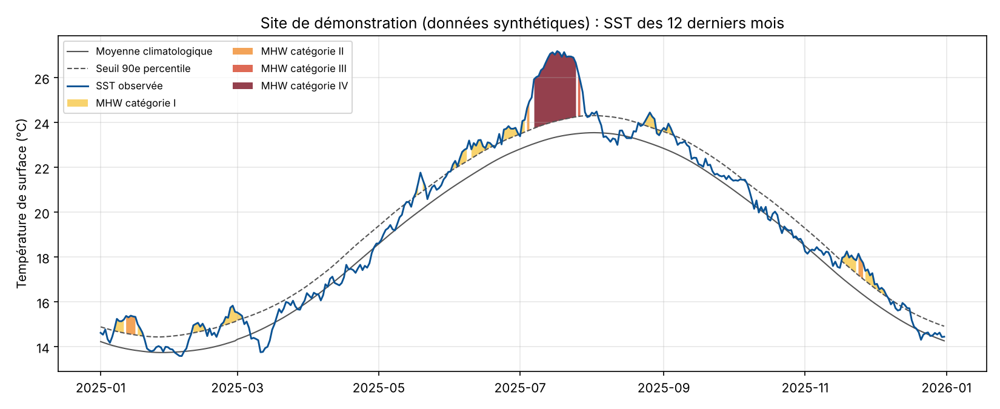
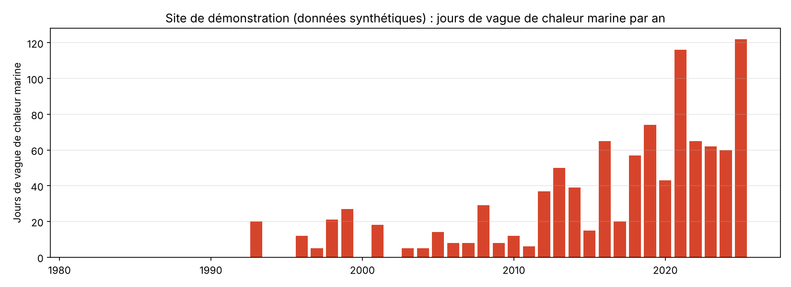

# MHW Watch 🌊🔥

**Détection et suivi des vagues de chaleur marines dans les aires marines protégées (AMP), à partir de données satellites ouvertes.**

Les vagues de chaleur marines (*Marine Heatwaves*, MHW) sont l'une des menaces les plus directes pour les écosystèmes côtiers : mortalités massives de gorgonies et de posidonies en Méditerranée (2003, 2022), blanchissement de la Grande Barrière de corail, effondrement de forêts de kelp. Les gestionnaires d'AMP ont besoin de savoir *quand* et *à quel point* leur site est touché.

MHW Watch télécharge 40+ ans de température de surface de la mer (SST) mesurée par satellite, calcule la climatologie de chaque site, détecte les vagues de chaleur selon la **méthode scientifique de référence (Hobday et al., 2016 et 2018)** et produit des tableaux et des graphiques prêts à être partagés.



## Pourquoi ce projet (pour un portfolio « tech pour l'océan »)

- **Données réelles et reconnues** : NOAA OISST v2.1, utilisée par Copernicus, Mercator Ocean, l'Ifremer et la communauté scientifique.
- **Méthode publiée** : la détection suit exactement la définition de Hobday, ce qui rend les résultats comparables à la littérature.
- **Compétences recherchées** dans le secteur (Mercator Ocean, CLS, Ifremer, Global Fishing Watch, OFB, start-ups « ocean tech ») : ingestion de données géospatiales, séries temporelles, Python scientifique, tests, visualisation.
- **Utilité concrète** : un indicateur que des gestionnaires d'AMP peuvent lire directement.
- **Évolutif** : le socle peut devenir un tableau de bord web, un système d'alertes, ou être croisé avec d'autres jeux de données (pêche, biodiversité).

## Installation

```bash
python -m venv .venv
source .venv/bin/activate          # Windows : .venv\Scripts\activate
pip install -e ".[dev]"
```

## Utilisation

```bash
# Lister les AMP préconfigurées
mhw-watch sites

# Analyser une AMP (télécharge les données NOAA, mises en cache dans data/)
mhw-watch analyze --site port-cros

# Analyser n'importe quel point du globe
mhw-watch analyze --lat 43.2 --lon 5.35 --name "Calanques"

# Essayer sans réseau, sur des données synthétiques
mhw-watch analyze --demo
```

Sans installation : `PYTHONPATH=src python -m mhw_watch analyze --demo`.

Le premier téléchargement d'un site (1982 → aujourd'hui) prend une à quelques minutes ; les suivants sont instantanés grâce au cache.

### Résultats (dans `outputs/<site>/`)

| Fichier | Contenu |
|---|---|
| `events.csv` | Un événement par ligne : début, fin, pic, durée, intensités max/moyenne/cumulée, catégorie |
| `yearly_summary.csv` | Jours de MHW et intensité cumulée par année (tendance) |
| `daily.csv` | Série quotidienne : SST, moyenne climatologique, seuil, anomalie, catégorie |
| `recent.png` | Les 12 derniers mois, vagues de chaleur colorées par catégorie |
| `yearly.png` | Nombre de jours de vague de chaleur par an |



## Méthode

1. **Climatologie** (période de référence 1991-2020 par défaut, conforme à l'OMM) : pour chaque jour de l'année, moyenne et 90ᵉ percentile des SST dans une fenêtre de ±5 jours, puis lissage sur 31 jours.
2. **Détection** : une MHW est une période d'au moins **5 jours** où la SST dépasse le seuil du 90ᵉ percentile ; deux événements séparés de **2 jours ou moins** sont fusionnés.
3. **Catégories** (Hobday et al., 2018) selon le multiple de l'écart (seuil − moyenne) atteint au pic : I Modérée, II Forte, III Sévère, IV Extrême.

Références :
- Hobday A.J. et al. (2016). *A hierarchical approach to defining marine heatwaves.* Progress in Oceanography, 141, 227-238.
- Hobday A.J. et al. (2018). *Categorizing and naming marine heatwaves.* Oceanography, 31(2), 162-173.
- Huang B. et al. (2021). *Improvements of the Daily Optimum Interpolation Sea Surface Temperature (DOISST) Version 2.1.* Journal of Climate, 34, 2923-2939.

## Données

- **NOAA OISST v2.1** : SST quotidienne, grille 0,25°, depuis septembre 1981, combinant satellites (AVHRR), navires et bouées.
- Accès sans clé d'API, par deux chemins essayés dans l'ordre :
  1. les serveurs **ERDDAP** de NOAA CoastWatch (`ncdcOisst21Agg_LonPM180` sur `coastwatch.pfeg.noaa.gov` puis `upwell.pfeg.noaa.gov`), rapides ;
  2. en secours, le serveur THREDDS/OPeNDAP de **NOAA PSL** (`noaa.oisst.v2.highres`). Il est lent (~0,3 s par jour demandé, soit de l'ordre de 20 minutes pour 1982 → aujourd'hui) ; chaque année téléchargée est gardée dans `data/psl/`, donc une interruption reprend là où elle s'est arrêtée.
- Délai de connexion court et une nouvelle tentative par serveur. Pour imposer un autre serveur ERDDAP qui sert le même jeu de données : `MHW_WATCH_ERDDAP=https://mon-serveur/erddap` (PowerShell : `$env:MHW_WATCH_ERDDAP = "https://mon-serveur/erddap"`).
- Si aucun serveur ne répond (réseau filtré, panne NOAA), la commande s'arrête avec un message explicatif ; `--demo` fonctionne toujours hors ligne.
- Limite connue : une résolution de 0,25° (~25 km) lisse les phénomènes très côtiers. Voir la feuille de route pour passer à des produits plus fins.

## Structure

```
mhw-watch/
├── src/mhw_watch/
│   ├── cli.py         # ligne de commande (sites, analyze)
│   ├── data.py        # téléchargement NOAA OISST (ERDDAP, PSL en secours) + cache
│   ├── detect.py      # climatologie, détection et catégories (Hobday)
│   ├── plot.py        # graphiques
│   ├── sites.py       # AMP préconfigurées
│   └── synthetic.py   # données de démo hors ligne
├── tests/             # pytest
├── data/              # cache des téléchargements (ignoré par git)
└── docs/              # images du README
```

Tests : `pytest`

## Feuille de route

Idées pour faire grandir le projet, dans un ordre raisonnable :

1. **Carte multi-AMP** : analyser toutes les AMP d'une région (contours depuis la base mondiale [WDPA / Protected Planet](https://www.protectedplanet.net/)) et moyenner la SST sur le polygone plutôt qu'en un point.
2. **Tableau de bord web** (Streamlit ou FastAPI + Leaflet) : carte des AMP colorée par état actuel, clic pour voir l'historique.
3. **Mise à jour automatique** : GitHub Actions quotidienne qui met à jour les données et publie le tableau de bord (GitHub Pages).
4. **Alertes** : notification (e-mail, Mastodon/Bluesky) quand une AMP entre en catégorie II ou plus.
5. **Données plus fines** : Copernicus Marine (SST Méditerranée haute résolution, produits `SST_MED_*`) via le paquet `copernicusmarine`.
6. **Impacts biologiques** : *Degree Heating Weeks* pour les coraux (NOAA Coral Reef Watch), croisement avec les observations de mortalité (base T-MEDNet en Méditerranée).
7. **Pression de pêche** : croiser avec l'effort de pêche de [Global Fishing Watch](https://globalfishingwatch.org/our-apis/) (API gratuite avec inscription) pour étudier stress thermique et pression humaine ensemble.

## Licence

MIT. Données NOAA OISST : domaine public.
